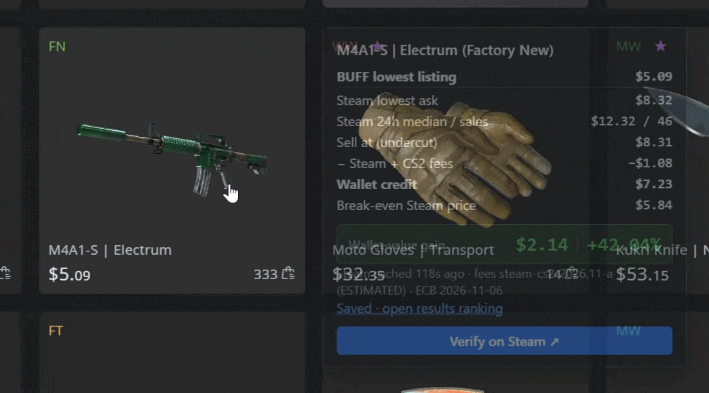
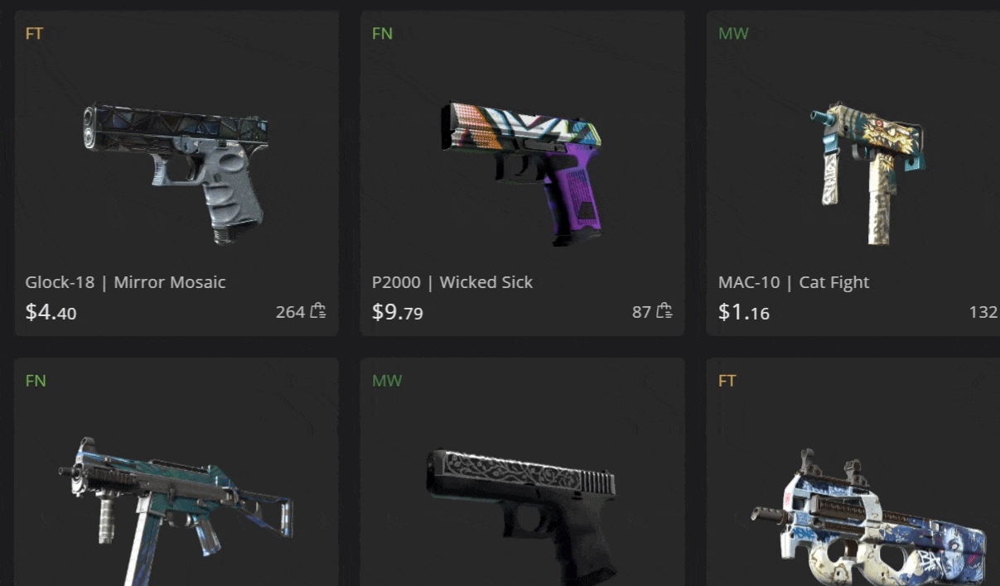
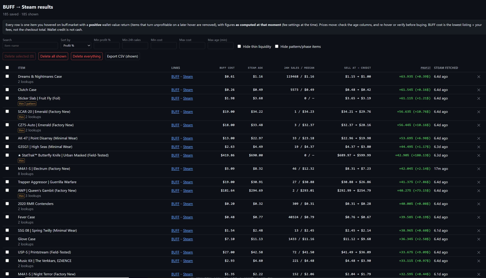

# CS2 Wallet-Value Checker

A Chrome extension for CS2 skin traders. Hover an item on **buff.market** and a popup shows the live
**Steam Community Market** price for the exact same item, Steam's fees, the Steam Wallet credit you'd
receive, and your wallet-value profit:

- the BUFF price, converted to your wallet currency
- the Steam lowest ask, 24h median and 24h sales
- the sell price, minus Steam and CS2 fees, giving your wallet credit
- profit, e.g. **+$6.26 │ +10.65%**

Every profitable lookup is saved to a **Results** page that ranks everything you've looked at.

The extension is read-only. It never clicks, buys, lists or trades anything, and it never sends your
cookies or login anywhere.

## Demo
Just hover over any card. You don't need to click, copy item names or open Steam in another tab.



*Hover a card for half a second. The popup opens over the next card with the Steam price, fees,
your wallet credit and the profit.*



*Move to another card and its own popup appears next to it, so you can scan a whole page in seconds.*

> **Not affiliated with Valve, Steam, NetEase or BUFF.Market.** This is an independent research aid. See
> [Disclaimer](#disclaimer) before using it.

## Install
1. Get the code: either `git clone` this repository, or click **Code → Download ZIP** on GitHub and unzip it.
2. Open `chrome://extensions` (also works in Edge and Brave) and turn on **Developer mode**.
3. Click **Load unpacked** and select the repository folder (the one containing `manifest.json`).
4. Open the extension's **Details → Extension options** and set:
   - your **Steam wallet currency** (USD, EUR or GBP)
   - any BUFF payment fees you pay

   Defaults: USD, no fees, a 1¢ undercut, at most 12 Steam lookups a minute.

## Using it
- **Hover** a card on [buff.market](https://buff.market/market/all) for about half a second to see the popup.
- **Verify on Steam ↗** opens the exact Steam listing with an overlay. Select the variant it tells you
  to, type the lowest price you see, and it recomputes the profit.
- **Results:** click the toolbar icon, or the link in the popup.

### Where it works
The popup reads the price printed on each BUFF.Market card. That price means different things on
different tabs, so the extension checks which page you're on. Results checked on 2026-11-01:

| Page | What the card price is | What the extension does |
|---|---|---|
| **Market → All Items** (including search and filters) | Cheapest sell listing ✅ | Full popup. **Use this page.** |
| Best Deals, Popular | One specific listing, sometimes pricier than the cheapest, and possibly with a float or pattern premium | Popup with a ⚠ warning; the Results row is tagged |
| Sticker Combos, Gold Stickers | A listing with stickers whose price includes the sticker premium | Blocked: no lookup, nothing saved |
| Recent Buy Orders | A **buy order**, not a sell listing | Blocked: no lookup, nothing saved |
| 2014 Katowice, item detail pages | The cards have no item link | No popup |
| Any other page | Not checked | Popup with a ⚠ "not verified" warning |

### Results page
Every profitable item you hover is collected on one page, so after browsing BUFF.Market you can sort
everything you've seen by profit and pick the best deals.



**Your results are kept.** They stay when you close the tab, restart the browser or computer, or reload
or update the extension, so you can browse over several sessions and come back to the ranking. Rows
only disappear when:
- you delete them,
- an item turns unprofitable on a later hover,
- the 5,000-item limit is reached (the oldest go first), or
- the extension is removed.

With "Load unpacked", Chrome treats the folder location as part of the extension's identity. Moving
the folder or loading it from a new place starts with an empty Results page, so use **Export CSV**
first if you want a copy.

- **What's stored:** only items with a **positive** return. An item that's no longer profitable when
  you hover it again is removed.
- **Columns:** Item, Links (BUFF – Steam), BUFF cost, Steam ask, 24h sales/median, Sell at → credit,
  **Profit** (`+4.12% (+5.03$)`) and Steam fetched.
- **Frozen figures:** each row keeps the figures exactly as they were computed at the time, including
  your fee settings and the exchange-rate date used.
- **Sorting and filters:** sort by profit % (the percentage only), BUFF cost, 24h sales or most recent.
  Filter by name, minimum profit %, minimum 24h sales, cost range and maximum age, and hide
  thin-liquidity or pattern/phase items.
- **Deleting:** delete one row, the selected rows, all rows shown, or everything.
- **Export:** export the rows shown to CSV, with UTC timestamps.
- **Storage:** stored only in this browser profile (`chrome.storage.local`), not synced to other
  devices. You can turn saving off in the options.

## How the numbers are produced
| Value | How |
|---|---|
| Item identity | The card's own link, `/market/goods/cs2/<exact Steam market_hash_name>`. No fuzzy matching |
| BUFF price | The card's price (the item's lowest listing). The `($…)` next to it is BUFF's currency conversion, not a Steam price |
| BUFF cost | Lowest listing, converted at the [ECB](https://www.ecb.europa.eu/) reference rate, plus your FX markup and fees. Not the checkout total |
| Steam prices | Steam's public price summary, in your wallet currency: lowest ask, 24h median and 24h sales. Cached for 5 minutes |
| Sell price | The **lower** of (lowest ask − undercut) and the 24h median |
| Fees and credit | Integer-cent fee model: 5% Steam + 10% CS2, each component rounded down with a 1¢ minimum, inverted exactly by binary search. The rounding rules are community-derived, so the fees are labelled an **estimate** |

Exchange rates: European Central Bank reference rates. USD values for other currencies are cross rates
derived via EUR.

## Limitations
- **Steam's new "Market Beta" listing page** groups every exterior and StatTrak/Souvenir version of a
  skin into one page and mixes them in its listing feed. So the verify overlay never reads a price by
  itself; you select the variant and type the price.
- **24h data only.** Steam's price summary has no 7-day history and no buy-order depth.
- **Premiums aren't priced:** float, pattern, Doppler phase and stickers.
- **Rate limits:** Steam doesn't publish them. The extension stays at 12 lookups a minute or below, and
  a 429 response pauses lookups for 5 minutes. Steam's listing pages throttle much sooner than its price
  endpoint, and both share your IP address with your normal Steam browsing.
- **Fragile page reading:** if BUFF.Market changes its page layout, the popup can break. The two things
  it reads are the card links (`a[href*="/market/goods/cs2/"]`) and the price element (`.user-price`).
  Page support lives in `pageSupport()` in `src/core.js`.

## Disclaimer
- **Independent and unofficial.** Not affiliated with, endorsed by or sponsored by Valve Corporation,
  Steam, NetEase or BUFF.Market. All trademarks belong to their owners.
- **Terms of use.** Steam's price endpoint is undocumented and may change or stop working. Steam's
  Subscriber Agreement restricts automated access, and BUFF.Market's terms restrict scraping tools and
  plug-ins. This extension only reads the card you hover and makes one lookup per hover. Whether that's
  acceptable under each site's terms is **your decision and your responsibility**.
- **Not financial advice.** Steam Wallet credit is not cash and can't be withdrawn. Prices move, fees
  are estimates, and nothing here guarantees a profit. Check every listing yourself before buying.

## Development
No build step: the extension is plain JavaScript (Manifest V3).

```bash
npm test                    # unit tests: fee model, price parsing, page support, ranking (no install needed)

# Live end-to-end tests: they open the real buff.market and make a few Steam lookups. Run them sparingly.
npm install && npm run e2e:install
node test/e2e.mjs <outdir>          # popup + verify tab (~3 Steam lookups)
node test/e2e-results.mjs <outdir>  # Results ranking + deletion (up to 8 lookups)
node test/e2e-pages.mjs             # Recent Buy Orders blocked, All Items works (1 lookup)
node test/e2e-anim.mjs <outdir>     # fade timings, loader states (2 lookups)
node test/e2e-layout.mjs <outdir>   # popup placement, spinner with reduced motion (2 lookups)
```

`test/python-fee-table.json` contains reference fee values from an independent Python implementation.
The unit tests check the JavaScript fee model against all of them.

## License
[MIT](LICENSE)
